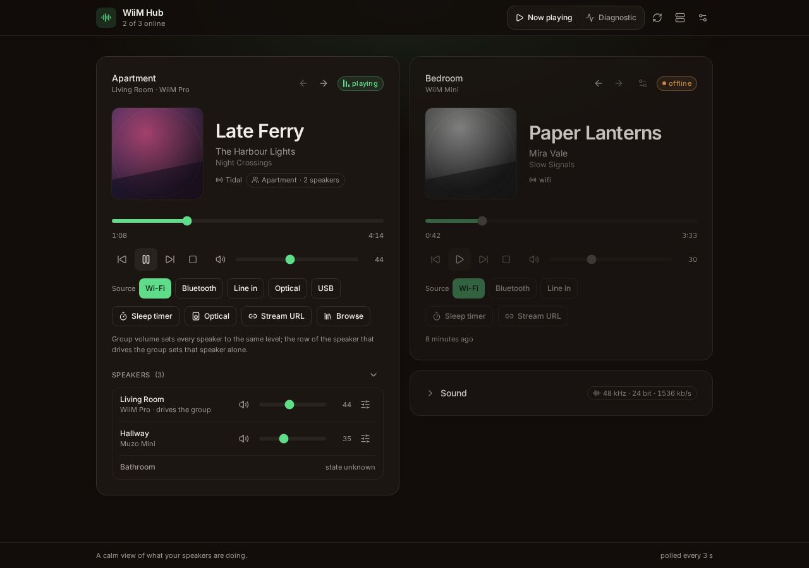
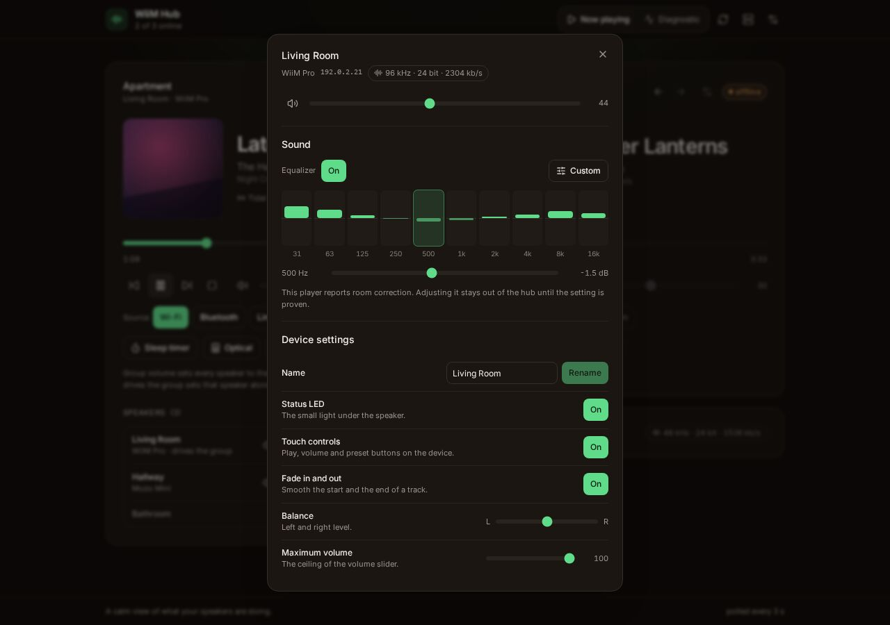
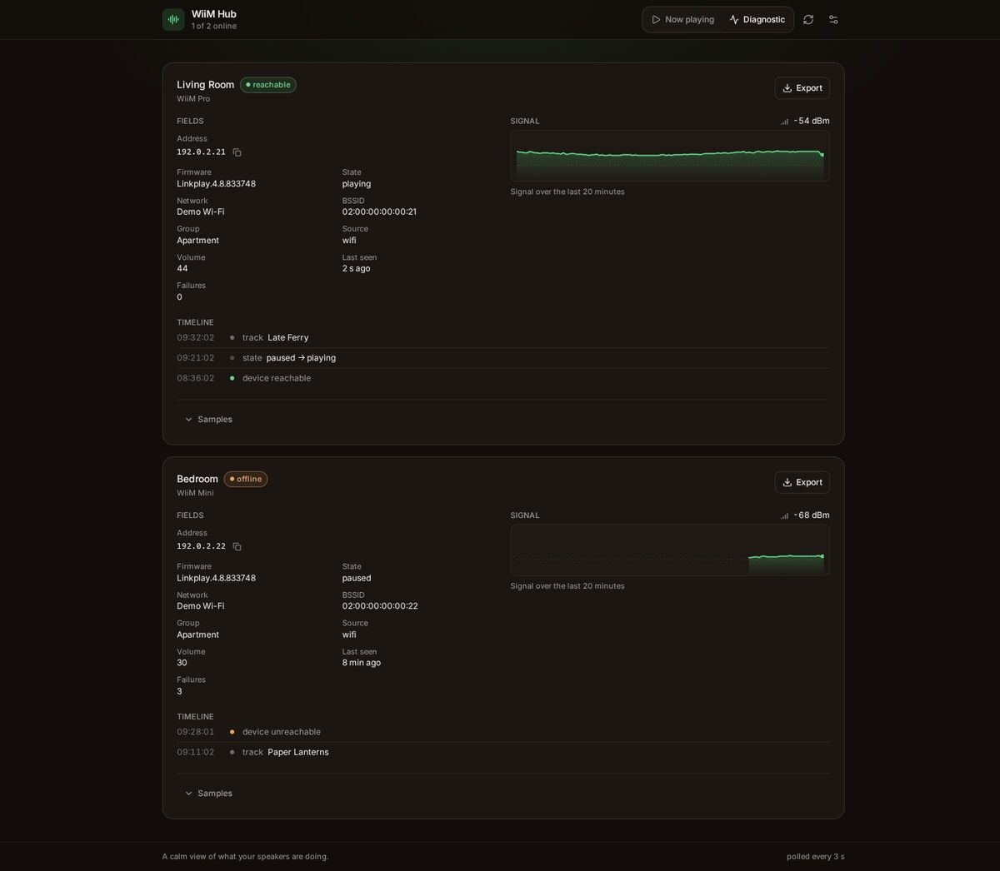
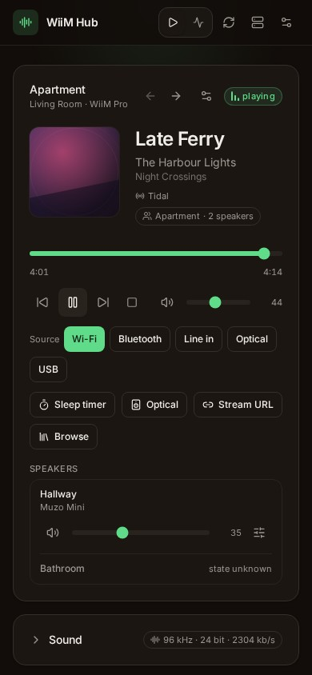

<p align="center"></p>

# WiiM Hub

[](https://github.com/openhoat/wiim-hub/actions/workflows/ci.yml)
[](LICENSE)
[](package.json)


**A local web page for the WiiM players on your network**: what each one is playing, what it reports
about itself, and the controls you need when the vendor app is not at hand.

Self-hosted, one process, no database, no runtime dependency. Every speaker gets its own card, its
own state and its own write queue, so a mixed fleet (Pro, Mini, Amp, Ultra, OEM LinkPlay players) is
the normal case.

**[Documentation](https://openhoat.github.io/wiim-hub/)** ·
[Features](https://openhoat.github.io/wiim-hub/features) ·
[Quick start](https://openhoat.github.io/wiim-hub/guide/quick-start) ·
[Configuration](https://openhoat.github.io/wiim-hub/guide/configuration) ·
[How it works](https://openhoat.github.io/wiim-hub/how-it-works)



## Two views, one dataset

A **now playing** view for everyday use: art, track, progress, volume, presets, sleep timer, audio
route, and a stream URL the speaker fetches itself. A **diagnostic** view for support: raw fields,
signal history, event log, and findings that quote the number they come from. A card folds to its
header in the diagnostic view, and the arrows in a now playing header set an order the page keeps
per browser, so the speaker you care about stays first.

|                                    |                                               |
| ---------------------------------- | --------------------------------------------- |
|  |  |

<p align="center"></p>

The captures come from the demo mode: simulated speakers, invented titles, documentation addresses.

## Run it

```sh
docker run --rm -p 8090:8090 -e DEVICE_HOSTS=192.168.1.10 ghcr.io/openhoat/wiim-hub:latest
```

Then open `http://localhost:8090`. `DEVICE_HOSTS` is the only variable you have to set: a comma
separated list of addresses or names (`kitchen.local`). Everything else has a default, and the full
table is in [Configuration](https://openhoat.github.io/wiim-hub/guide/configuration).

From sources, with Node 22.18+, it is the same three steps:

```sh
npm ci
npm run build
npm start
```

**No speaker at hand?** `npm run build && npm run demo` serves the same interface over two simulated
players, with a real write path: a volume change lands in the state the page renders. The
end-to-end suite runs against it, which is why the project is testable without hardware.

The page also **installs as a web app**: Chrome and Edge offer it from the address bar, it then runs
in a window of its own, with the project's icon. A service worker caches the shell and never the
API, so it opens without a network, and the cards then show the last state received, with its age.
An installed app takes a deploy without a reinstall: the page is served network first, and a window
left open offers a reload when the new worker is ready. The icon is the one exception, since Chrome
on desktop never updates `icons` on an installed app.

## What it does

- **Controls, without the app**: transport, seek, volume and mute, source, presets, sleep timer,
  output route, equalizer and device settings. Each write is validated by the hub and serialised per
  device, so a slider drag cannot race itself.
- **Devices by address or by name**: `kitchen.local` is re-resolved in the background through a chain
  of sources (static pairs, the router's lease table, the system resolver, then a built-in mDNS
  query), so a DHCP lease change stays invisible instead of making a speaker disappear, and the
  report says which source answered.
- **A mixed fleet is the normal case**: transport, names and capabilities are probed per device,
  never assumed. Missing fields stay unknown instead of being guessed.
- **Two languages, one page**: English and French, the diagnostic findings and the guided flows
  included. Numbers, ages and plurals follow the language the page is in: a count picks the plural
  branch of its own dictionary instead of carrying a `(s)`, and an outage older than a day reads
  "3 days ago", not "72 h ago".
- **Alerts that go out**: the same rules can post to a JSON webhook or an ntfy topic, once when a rule
  appears and not while it lasts, filtered by rule and severity, with a one hour quiet period.
- **An agent surface**: a small MCP server, beside the hub and a client of its HTTP API, gives an
  agent the fleet state, one diagnostic report, one settings sheet and one intent per call. It runs
  on demand over stdio, so the hub keeps its dependencies to node built-ins.
- **Two doors**: a browser authenticates at the ingress and the hub reads the identity the forward
  auth leaves on the request; an agent sends a key instead, `WIIM_HUB_TOKEN`, compared in constant
  time. Unset, the hub keeps its LAN contract and asks for nothing.
- **Evidence over verdicts**: twelve rules turn the device's own counters into short facts, each with
  its number and the command it came from, and the same content exports as a Markdown report to
  paste into a support thread.
- **Push when it can, poll when it cannot**: UPnP events arrive in under a second and relax the poll
  to 15 s; a broken channel degrades to polling, nothing is lost.
- **No vendor code**: only the HTTP interface the players expose on the LAN, measured and recorded in
  the [feature research](https://openhoat.github.io/wiim-hub/feature-research).

## Documentation

| Page                                                                     | What it covers                                                    |
| ------------------------------------------------------------------------ | ----------------------------------------------------------------- |
| [Quick start](https://openhoat.github.io/wiim-hub/guide/quick-start)     | Docker, sources, demo, first device                               |
| [Configuration](https://openhoat.github.io/wiim-hub/guide/configuration) | Environment variables, reverse proxy, sizing, logs                |
| [Devices](https://openhoat.github.io/wiim-hub/guide/devices)             | Explicit list, discovery, mDNS names, mixed fleet, external input |
| [UPnP events](https://openhoat.github.io/wiim-hub/guide/events)          | Push instead of poll, and how it degrades                         |
| [Demo mode](https://openhoat.github.io/wiim-hub/guide/demo)              | The two simulated players and what is not faked                   |
| [Development](https://openhoat.github.io/wiim-hub/guide/development)     | The gate, the suites, the docs site                               |
| [How it works](https://openhoat.github.io/wiim-hub/how-it-works)         | Poll loop, write queue, findings, cover relay, module map         |
| [HTTP API](https://openhoat.github.io/wiim-hub/reference/http-api)       | Routes, accepted intents, relay rules                             |

In the repository: [`CHANGELOG.md`](CHANGELOG.md), [`KANBAN.md`](KANBAN.md),
[decision records](docs/adr), [`CONTRIBUTING.md`](CONTRIBUTING.md) and [`SECURITY.md`](SECURITY.md).
A `v*` tag publishes the image to `ghcr.io/openhoat/wiim-hub` through
[`docker.yml`](.github/workflows/docker.yml).

## Security

The hub has **no built-in authentication, by design**: identity belongs to the ingress. Run it on a
private network, or behind a forward-auth proxy such as oauth2-proxy or Authelia, and keep `/health`
reachable without a session if a probe needs it. The control routes write to the speaker, so exposing
the hub without an authentication layer is not a supported configuration.

## Independent project

Not affiliated with, endorsed by or supported by WiiM or LinkPlay Technology. It ships no vendor
code: it only calls the HTTP interface the players expose on the local network. WiiM and LinkPlay are
trademarks of their respective owners, named here to say what the hub works with and nothing more.

## License

MIT, see [LICENSE](LICENSE).
