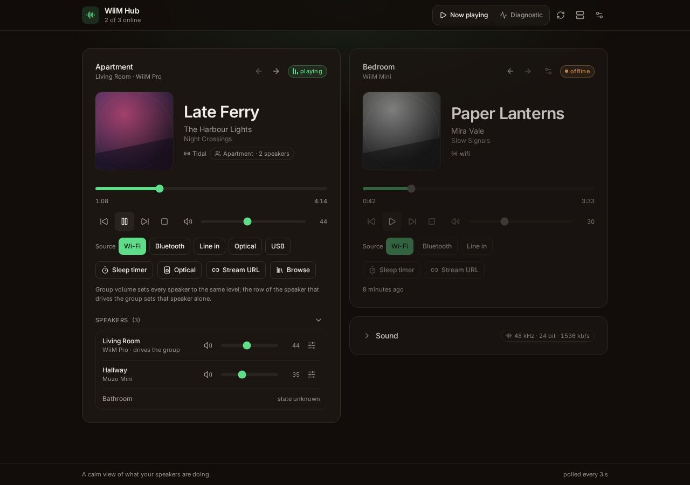

# Demo mode

No speaker at hand? The repository ships a demo that serves the same bundle over two simulated
players. It needs no device, no network and no extra dependency.

```sh
npm ci
npm run build        # the demo serves the same dist/ as the hub
npm run demo         # http://localhost:8090, PORT=8091 to move it
```

## What is simulated

Two players, on documentation addresses (`192.0.2.21` and `192.0.2.22`):

| Device  | State                                                                           |
| ------- | ------------------------------------------------------------------------------- |
| Living  | playing, with a generated cover, a saved group it drives, and a full sound card |
| Bedroom | offline, three failed polls, with a group it remembers but does not run         |

Both report a deterministic signal history, so the sparkline has a shape rather than noise, and the
offline card carries the findings a real one would: a device that does not answer, and a group
that is saved without running.

What is **not** faked is the path a write takes. The demo goes through the same action parser and
the same command builder as the hub: the volume ceiling, the available inputs and outputs and the
supported commands are enforced there too. Only the last step differs, the command mutates memory
instead of reaching a speaker. Every simulated state is typed as the real `DeviceState`, so a
change in the polling code fails the demo at compile time instead of letting it drift.



## What it is for

- **Trying the interface** before deciding to install anything.
- **Screenshots**: the images in the README come from the demo, with invented titles and generated
  covers.
- **The end-to-end suite**: Playwright drives the demo, which is why the suite runs unattended. See
  [the decision record](https://github.com/openhoat/wiim-hub/blob/main/docs/adr/0002-demo-mode-drives-the-end-to-end-suite.md).

## Ports

The demo listens on `8090` by default, exactly like the hub, so the two are never run together by
accident in the same shell. The end-to-end suite starts it on **8091**, so a hub or a demo left
running does not disturb a test run.

`8091` is also the default `UPNP_PORT`: running the demo and an event listener at the same time
fails with `EADDRINUSE`. The demo does not subscribe to anything, so that combination is a
misconfiguration rather than a supported setup.
