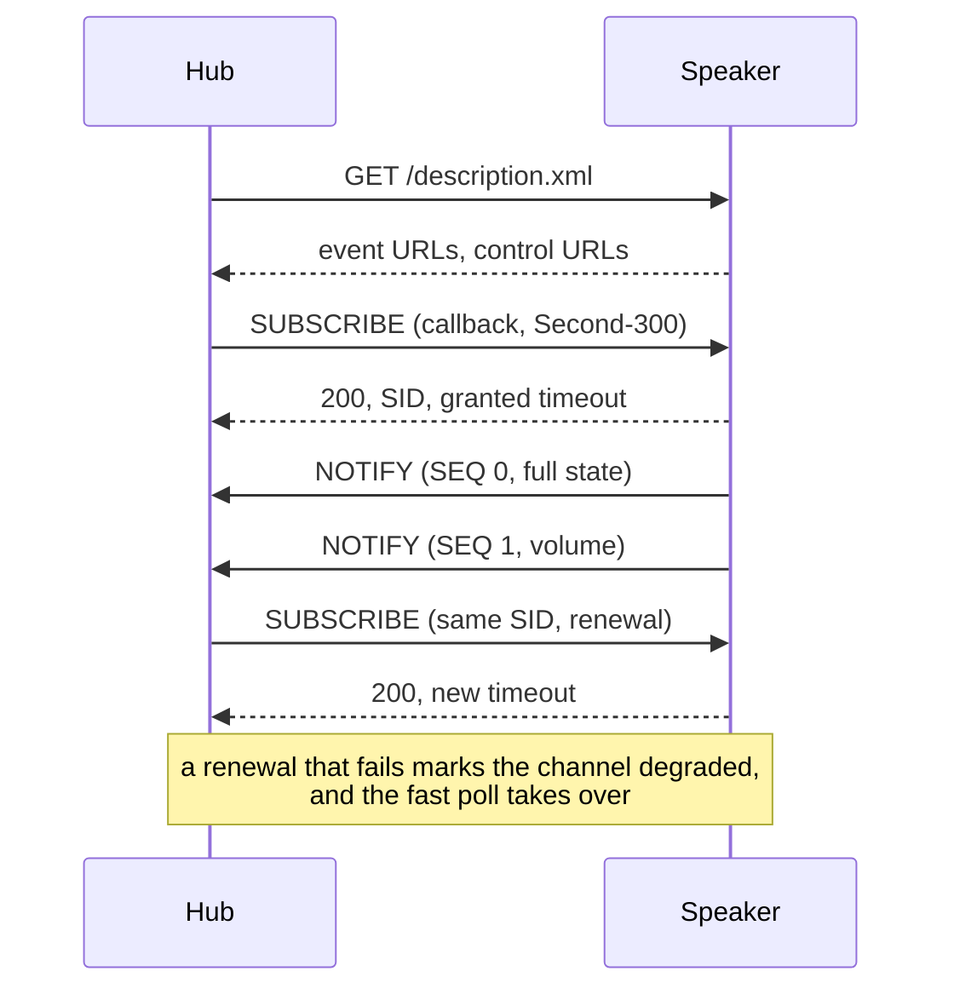

# UPnP events

Polling every three seconds is fine, but the players can also push: they implement the UPnP event
model, and the hub subscribes to it when it is told how to be reached.

## Turning it on

Two variables:

```sh
UPNP_CALLBACK=http://192.168.1.10:8091   # the address a speaker can reach the hub on
UPNP_PORT=8091                           # the listener, separate from PORT
```

`UPNP_CALLBACK` is the base URL the players will call. It must be reachable **from the speakers**,
not from your browser: a hub in a bridged container, or on another machine than the speakers, gets
subscribed but never called. When in doubt, leave it empty: the hub then polls and the diagnostic
view shows the event channel as off.

`UPNP_PORT` exists because the listener is not the page: it is a separate HTTP server the hub opens
for the players, and it must not collide with `PORT`.

## What the hub subscribes to

Two services per device, the only two that carry something the page shows:

| Service            | What arrives                              |
| ------------------ | ----------------------------------------- |
| `AVTransport`      | transport state, track metadata, duration |
| `RenderingControl` | volume, mute                              |

The subscription is renewed before its granted timeout expires, on the same `SID`: renewing on a
new one would leave the device emitting to a subscription nobody holds. The hub asks for 300
seconds and takes what the device grants.

Notifications arrive on `/upnp/<token>`, one token per device, and each one is checked before it is
applied:

- the token must be one the hub issued;
- the source address must be the device the token belongs to;
- the sequence number is kept per `SID`, and a notification that arrives twice or out of order is
  dropped: it is the network, not a state change.



## What changes when it works

- The playback fields arrive in under a second instead of up to three.
- The poll relaxes to `SLOW_POLL_MS` (15 s by default) while every device is subscribed: it keeps
  reading what nobody events, which is the position, the counters, the group, the inputs and the
  equalizer.
- A write does not wait for the next notification: the page paints the expected value, the write
  goes out through the queue, and the event or the poll confirms it.

## When it does not

The channel is reported as `degraded`, and the hub goes back to the fast poll, in two cases:

- the renewal failed, which is what a device reboot or a network change looks like from the hub
  side;
- two polls contradicted the channel, so the push stream is stale while the device still answers.

Nothing is lost in either case: the poll is the source of truth, the events only make it faster.
The diagnostic view names the current state of the channel for the selected device.

## Network requirements

- The listener is **plain http**: the devices do not speak TLS to a callback, whatever their own
  API does.
- The players reach the hub on the LAN, so the address in `UPNP_CALLBACK` has to be a LAN address
  of the host, not `localhost` and not a public name.
- The hub reaches the device description on port 49152 over http, which is separate from the
  control API on 443 (or 80 on older builds).
