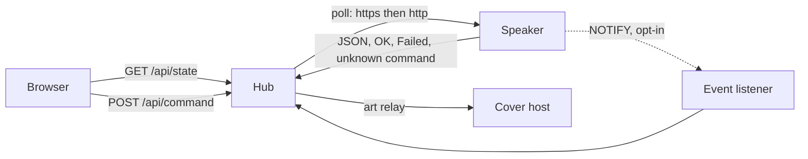
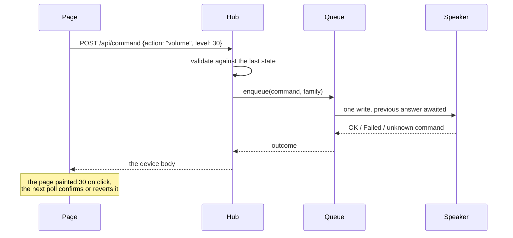
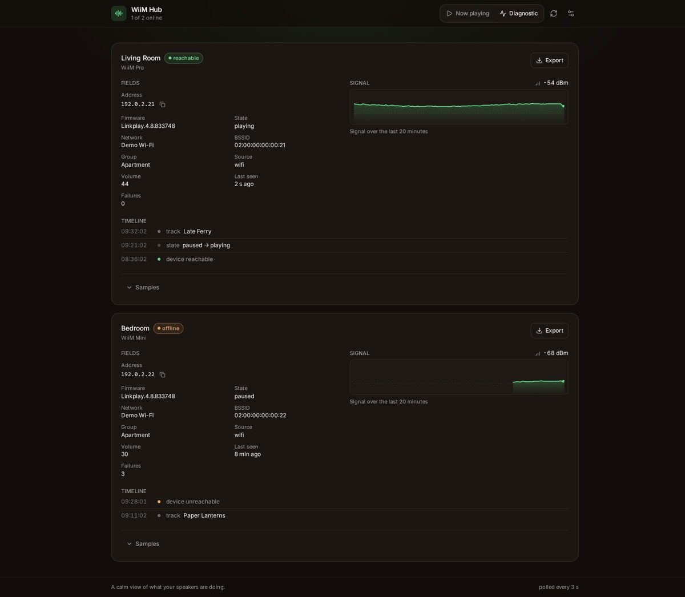

# How it works

One process, no database, no runtime dependency. The hub reads the same local API the vendor app
uses, keeps the readings in memory, and serves one page for every speaker.

## The shape of the data

Each device gets a `DeviceState`: identity, network, playback, volume, group, inputs, outputs,
sound card, and the event channel status. The hub builds it from the device's own answers, and it
never invents a field the device did not report: an absent value stays unknown rather than being
guessed from a default.



## The poll loop

Every `POLL_MS`, each device is polled in parallel:

1. the transport is chosen from the last success (https first, http remembered), so a mixed
   firmware fleet pays at most one extra request per device;
2. the readings are requested, parsed, and merged into the state;
3. the reading feeds the ring buffers: 400 signal samples (about 20 minutes at 3 s) and the event
   log of reachability, playback state and track changes.

A failed poll does not delete the device: the card stays, marked offline, with the number of
failures and the last known values. That is the difference between "the speaker stopped answering"
and "the hub forgot it".

The page polls `/api/state` on the same period, one request at a time, chained from the previous
answer so a slow hub stretches the interval instead of stacking requests. The loop stops while the
tab is hidden and reads immediately on return. `pollMs` travels in the answer, so the page and the
hub never disagree on the cadence.

## Names

A host entry may be an address or a name. An address is used as is; a name goes through a chain of
resolvers, in order, and the first answer wins: the operator's static pairs (`DEVICE_STATIC_HOSTS`),
the router's lease table when the hub can read it (`DEVICE_LEASES_FILE`), the system resolver, then
the built-in mDNS query in `server/mdns.ts`.

The chain exists because no single source covers a home network: a container on a bridge does not
see multicast, a container is often blind to the host resolver, and a router that handed the address
out already knows it. Each source is optional, so the chain degrades to what the hub can see.

Resolution never blocks a poll: `target()` answers with the last known address (the host itself
before anything answered) and refreshes in the background. The timing is explicit in `resolve.ts`
rather than guessed at each call site: an answer lives 30 s, a failure is retried after 60 s, two
attempts are at least 5 s apart, and `forget()` (a device that stopped answering) drops the attempt
without dropping the fallback. The lease file is read once a minute at most.

The report names the source that answered, because an address that came from the lease table says
mDNS never answered, and that is a different problem from an address mDNS got wrong.

## The write path

A control sends an **intent**, never a raw device command:



The validation is where the hub owns the write surface: it bounds the volume by the device's
`max_volume`, refuses an input or an output the device does not report, refuses an equalizer gain
outside the measured range, and refuses a stream URL that is not http or https. `unknown command` is
a capability answer, not a transient failure: the control is then shown as unsupported instead of
being retried.

The queue is **one writer per device**. The device is a small embedded HTTP server: two concurrent
writes can interleave, and a slider drag would otherwise emit dozens of requests whose answers
arrive out of order. Commands are queued in order, except the families where only the last value
matters (`volume`, `seek`): a pending one of the same family takes the new value in place, and every
caller waiting on it receives the same final answer.

## Findings, and the report

The device reports counters; the hub turns them into facts. Twelve rules cover a device that does
not answer, a weak link, Wi-Fi or wired drops, ping failures, abnormal reboots, crash counters, lost
UPnP actions, flash wear, hardware faults, a degraded event channel and a running sleep timer.
Below the thresholds, nothing is reported: a clean device says "no anomaly detected" and lists what
was read, so a clean answer shows its basis.

Diagnostics are refreshed on their own cadence (60 s) rather than on every poll, and the answer is a
list of findings, each with the numbers that support it and the command it came from.



`GET /api/report?host=<address>` renders the same findings as an English Markdown report: the table
of readings, the findings, the guided checks, the capability inventory and the raw answers it was
built from. It is meant to be pasted into a support thread, which is why it quotes the evidence
rather than a conclusion.

## The guided checks

Four flows (no sound, drops, wrong output, cannot join a group) walk the cheapest question first and
stop at the first check that does not pass. `unknown` is not a pass: a check that could not be read
says so instead of being counted as healthy. The flows read the same state the diagnostic view
shows; they do not run their own probes.

## The capability inventory

Some controls exist on one model and not on another. The inventory probes the commands the hub
knows (18 of them, cached for 60 s) and classifies each answer: supported, `unknown command`,
`Failed`, empty, or unreachable when the device does not answer at all. It also records the path
that worked (`host`, address, the source that resolved the name, then scheme), which is the first
thing to check when a device is configured by name.

## The streaming tiers

`streamServicesCapability` answers the services a player can drive, with the quality tiers its
firmware publishes for each one. The hub reads it when the diagnostic card opens, keeps it for five
minutes per address, and never in the poll payload: it changes with a firmware update, not with a
track.

The payload has no uniform shape. Some families list a ladder of names (`SD < HD < UHD`), Qobuz
lists format ids, CalmRadio lists bitrates, KKBOX lists codec tokens, and most services (the cast
endpoints above all) list nothing because the app that casts to them owns the levels. The card shows
the top of the ladder the device listed, the whole ladder in the row tooltip, and a dash where the
firmware says nothing. A named tier is never turned into a bitrate: `HI_RES` is what this model
reports, and `24 bit / 192 kHz` would be a claim about a catalogue.

The "in use" badge comes from `getPlayerStatusEx.vendor`, not from the `active` flag: the Pro
answers `active` for Spotify while it streams YouTube Music.

## The cover relay

Album art is fetched by the hub, not by the browser. Two reasons: an https page cannot load a cover
served by the speaker over plain http, and some streaming services hand out a URL that only resolves
on the LAN.

The relay is deliberately narrow. It only accepts a cover URI the device itself reported on its last
poll (track or preset), never an arbitrary URL. Beyond that:

- the name is resolved once, and the connection goes to the address that was checked;
- a private, loopback, link-local, carrier NAT or multicast address is refused, with one exception:
  the speaker's own address;
- the body decides the type (JPEG, PNG, GIF, WebP from the first bytes), and a text or HTML answer
  is refused even when it claims to be an image;
- the transfer stops at 6 MiB and 5 s, and every refusal is logged with its reason.

## The page

React 19, Vite, Tailwind and Radix primitives, with a self-hosted Inter variable font. Two views
share one dataset: a now playing view built around the album art, and a diagnostic view built
around the numbers. Every control paints the expected value immediately and lets the next poll
confirm or revert it; the reconciliation lives in `src/lib/optimistic.ts` so it runs without a
browser.

Language and theme follow the browser, can be overridden in the header, and are remembered per
browser. The selected view is remembered the same way.

So is the order of the cards, and that one needs pinning. The hub answers its devices in the order
it happens to hold them, which moves when a speaker joins or is rediscovered, so two cards could
swap with no visible reason. The page keeps the first order it saw, appends a speaker it has never
seen, and stores the list in `localStorage` (`src/lib/layout.ts`); the arrows in a card header move
it against its neighbour, and only that gesture changes the order. The diagnostic view reads the
same list, and each of its cards folds to the header, remembered per address: on a phone, the
fleet reads as names first.

The page also installs as a web app, and a service worker (`public/sw.js`) caches what makes that
worth doing: the document, its bundle, the font and the icons, so the shell opens without a network.
The split is deliberate. The shell changes only when the hub is redeployed, so a cached copy is
never wrong; `/api/` is the live truth, so it is never cached, and its failures stay visible. When
the hub stops answering, the cards keep the last state received (one snapshot in `localStorage`,
`src/lib/snapshot.ts`), dated under the banner, and their clock stops at the moment it was taken:
a seek bar must not advance on a position nobody measured.

Dialogs are bottom sheets on a phone, which puts them exactly where the on-screen keyboard appears.
The document asks the browser to resize the content rather than paint over it
(`interactive-widget=resizes-content`), and `src/lib/viewport.ts` measures what is left for the
engines that ignore the hint, publishing `--keyboard-inset` and `--visible-height`: a sheet sits
above the keyboard and never grows past the visible screen, so the field that was just focused
stays on screen with its button.

## Updates

Deploying a new image reaches the installed app on its next launch: the document is served network
first, so the fresh `index.html` brings the fresh bundle. A window that stayed open keeps the code
it loaded, and that is what `src/lib/updates.ts` handles.

A new worker waits instead of taking over. When it reaches `installed` while a page is controlled,
the page shows a banner with a reload button; the click activates the worker (`SKIP_WAITING`) and
reloads once the new one controls the page (`controllerchange` guarded by `reloadPending`, so the
first install does not reload anything). Nothing is swapped under the pointer, and the view, the
language and the last state survive the reload. A check runs when the app returns to the foreground
and every 30 min.

The manifest and the icons are the one cached group served **network first**: the browser reads them
at launch to decide what the app is called and how it looks, and a cache-first answer would describe
the release that was installed rather than the one running.

What the site cannot do is refresh the icon of an app already installed on desktop Chrome: `icons`
is not in the list of manifest fields Chrome updates, so that one still needs a reinstall. The
manifest carries `"id": "/"` so that a changed `start_url` updates the app instead of installing a
second one. Both rules come from
[How Chrome handles updates to the web app manifest](https://web.dev/articles/manifest-updates).

## Module map

```text
server/device/       device client, one module per area: transport fallback, the resolver
                     chain for names, payload readers, art relay, playback status, inputs and
                     outputs, presets, equalizer, multiroom, diagnostics, settings, and the
                     probe cache; index.ts holds DeviceState and the two entry points.
server/commands.ts   accepted intents, validation against the device state, command mapping
server/queue.ts      per-device write queue: one command in flight, coalescing by family
server/discovery.ts  SSDP discovery, filtered on WiiM and LinkPlay descriptions
server/mdns.ts       dependency-free mDNS A record resolver
server/upnp.ts       event subscriptions, notifications, renewal and fallback
server/findings.ts   diagnostic rules and the Markdown report
server/guides.ts     the four guided flows
server/inventory.ts  capability probing and its cache
server/services.ts   streaming services and the tiers the firmware publishes
server/server.ts     polling loop, ring buffers, HTTP routes, static bundle
server/demo.ts       the same routes over simulated speakers
src/                 React UI: components, settings and i18n provider, formatting helpers
src/lib/layout.ts    the card order and the folded cards, kept per browser
src/lib/updates.ts   worker registration, version checks, the reload the banner offers
src/lib/viewport.ts  the on-screen keyboard gap, published as two CSS variables
public/sw.js         service worker: the shell is cached, the API never is
e2e/                 Playwright suite, run against the demo mode
```

## Where the truth lives

Two files carry what was measured, and both are the reference before any code:

- [`docs/feature-research.md`](/feature-research): what the LinkPlay API exposes, what a real
  player answered, and the behaviour requirements per feature.
- [`docs/adr/`](/adr/0001-zero-runtime-dependencies): the decisions that are not obvious from the
  code.
