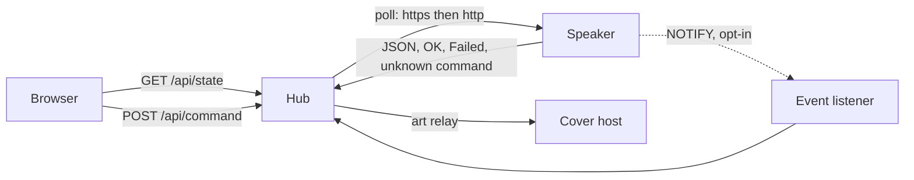
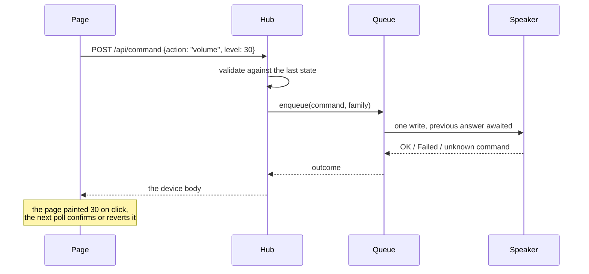

# How it works

One process, no database, no runtime dependency. The hub reads the same local API the vendor app
uses, keeps the readings in memory, and serves one page for every speaker.

## The shape of the data

Each device gets a `DeviceState`: identity, network, playback, volume, group, inputs, outputs,
sound card, and the event channel status. The hub builds it from the device's own answers, and it
never invents a field the device did not report: an absent value stays unknown rather than being
guessed from a default.



## The poll loop

Every `POLL_MS`, each device is polled in parallel:

1. the transport is chosen from the last success (https first, http remembered), so a mixed
   firmware fleet pays at most one extra request per device;
2. the readings are requested, parsed, and merged into the state;
3. the reading feeds the ring buffers: 400 signal samples (about 20 minutes at 3 s) and the event
   log of reachability, playback state and track changes.

A failed poll does not delete the device: the card stays, marked offline, with the number of
failures and the last known values. That is the difference between "the speaker stopped answering"
and "the hub forgot it".

The page polls `/api/state` on the same period, one request at a time, chained from the previous
answer so a slow hub stretches the interval instead of stacking requests. The loop stops while the
tab is hidden and reads immediately on return. `pollMs` travels in the answer, so the page and the
hub never disagree on the cadence.

## The write path

A control sends an **intent**, never a raw device command:



The validation is where the hub owns the write surface: it bounds the volume by the device's
`max_volume`, refuses an input or an output the device does not report, refuses an equalizer gain
outside the measured range, and refuses a stream URL that is not http or https. `unknown command` is
a capability answer, not a transient failure: the control is then shown as unsupported instead of
being retried.

The queue is **one writer per device**. The device is a small embedded HTTP server: two concurrent
writes can interleave, and a slider drag would otherwise emit dozens of requests whose answers
arrive out of order. Commands are queued in order, except the families where only the last value
matters (`volume`, `seek`): a pending one of the same family takes the new value in place, and every
caller waiting on it receives the same final answer.

## Findings, and the report

The device reports counters; the hub turns them into facts. Twelve rules cover a device that does
not answer, a weak link, Wi-Fi or wired drops, ping failures, abnormal reboots, crash counters, lost
UPnP actions, flash wear, hardware faults, a degraded event channel and a running sleep timer.
Below the thresholds, nothing is reported: a clean device says "no anomaly detected" and lists what
was read, so a clean answer shows its basis.

Diagnostics are refreshed on their own cadence (60 s) rather than on every poll, and the answer is a
list of findings, each with the numbers that support it and the command it came from.

`GET /api/report?host=<address>` renders the same findings as an English Markdown report: the table
of readings, the findings, the guided checks, the capability inventory and the raw answers it was
built from. It is meant to be pasted into a support thread, which is why it quotes the evidence
rather than a conclusion.

## The guided checks

Four flows (no sound, drops, wrong output, cannot join a group) walk the cheapest question first and
stop at the first check that does not pass. `unknown` is not a pass: a check that could not be read
says so instead of being counted as healthy. The flows read the same state the diagnostic view
shows; they do not run their own probes.

## The capability inventory

Some controls exist on one model and not on another. The inventory probes the commands the hub
knows (18 of them, cached for 60 s) and classifies each answer: supported, `unknown command`,
`Failed`, empty, or unreachable when the device does not answer at all. It also records the path
that worked (`host`, then address, then scheme), which is the first thing to check when a device is
configured by name.

## The cover relay

Album art is fetched by the hub, not by the browser. Two reasons: an https page cannot load a cover
served by the speaker over plain http, and some streaming services hand out a URL that only resolves
on the LAN.

The relay is deliberately narrow. It only accepts a cover URI the device itself reported on its last
poll (track or preset), never an arbitrary URL. Beyond that:

- the name is resolved once, and the connection goes to the address that was checked;
- a private, loopback, link-local, carrier NAT or multicast address is refused, with one exception:
  the speaker's own address;
- the body decides the type (JPEG, PNG, GIF, WebP from the first bytes), and a text or HTML answer
  is refused even when it claims to be an image;
- the transfer stops at 6 MiB and 5 s, and every refusal is logged with its reason.

## The page

React 19, Vite, Tailwind and Radix primitives, with a self-hosted Inter variable font. Two views
share one dataset: a now playing view built around the album art, and a diagnostic view built
around the numbers. Every control paints the expected value immediately and lets the next poll
confirm or revert it; the reconciliation lives in `src/lib/optimistic.ts` so it runs without a
browser.

Language and theme follow the browser, can be overridden in the header, and are remembered per
browser. The selected view is remembered the same way.

## Module map

```text
server/device.ts     device client: transport fallback, mDNS name resolution, parsing, art relay
server/commands.ts   accepted intents, validation against the device state, command mapping
server/queue.ts      per-device write queue: one command in flight, coalescing by family
server/discovery.ts  SSDP discovery, filtered on WiiM and LinkPlay descriptions
server/mdns.ts       dependency-free mDNS A record resolver
server/upnp.ts       event subscriptions, notifications, renewal and fallback
server/findings.ts   diagnostic rules and the Markdown report
server/guides.ts     the four guided flows
server/inventory.ts  capability probing and its cache
server/server.ts     polling loop, ring buffers, HTTP routes, static bundle
server/demo.ts       the same routes over simulated speakers
src/                 React UI: components, settings and i18n provider, formatting helpers
e2e/                 Playwright suite, run against the demo mode
```

## Where the truth lives

Two files carry what was measured, and both are the reference before any code:

- [`docs/feature-research.md`](/feature-research): what the LinkPlay API exposes, what a real
  player answered, and the behaviour requirements per feature.
- [`docs/adr/`](/adr/0001-zero-runtime-dependencies): the decisions that are not obvious from the
  code.
