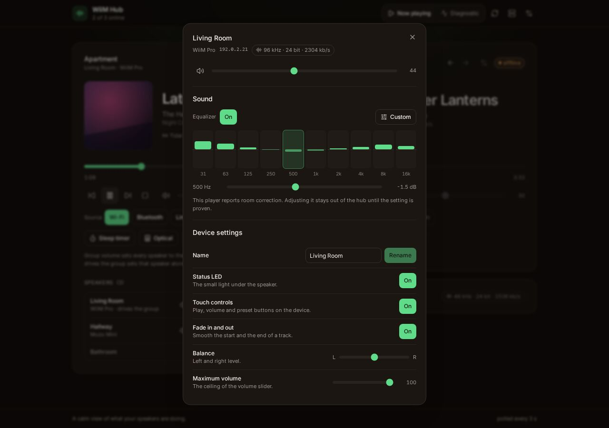
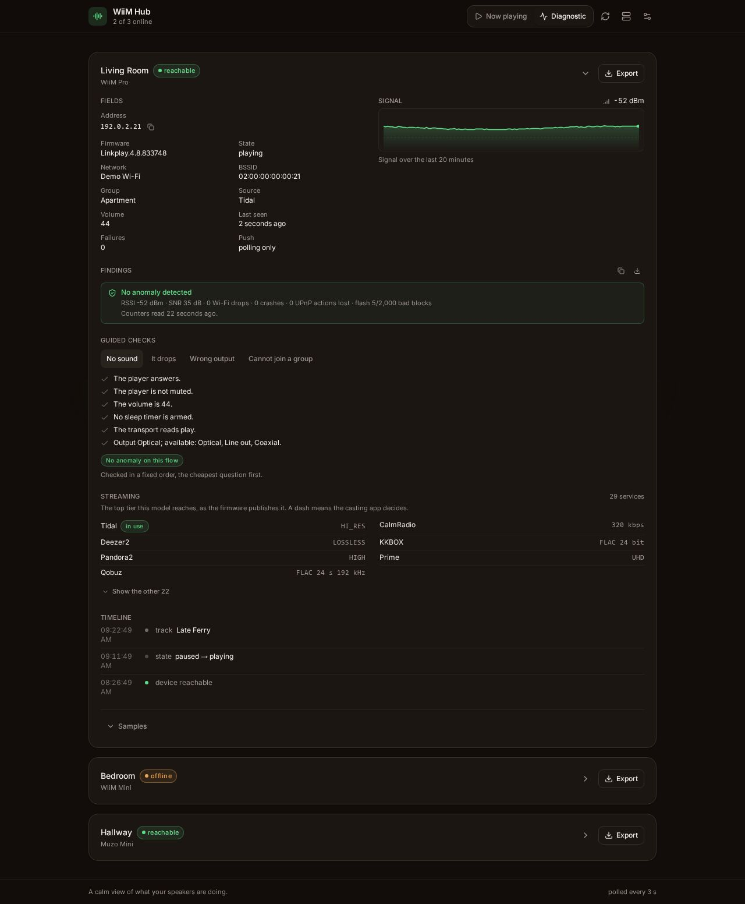
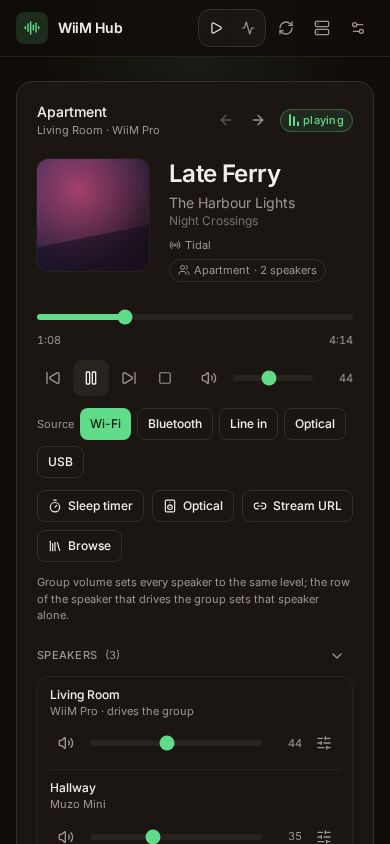

## What the hub is

A small self-hosted service that polls the players on your local network every few seconds and
serves one page for all of them. It is a complement to the vendor app, not a replacement for it:
the same device data, on a screen you already have open, in a browser and on a phone.

It ships no vendor code and calls only the HTTP interface the players expose on the LAN. Where a
behaviour was measured on a real player it is recorded in the
[feature research](/feature-research); where it is an inference, the page says so.

## What it looks like

Two readings of the same data: the sheet of one speaker, with its volume, its equalizer and its
settings, and the diagnostic view, which turns the device's own counters into short facts. Both fit
a phone, where the cards stack one per screen and nothing needs a zoom. A running group is one card
there too, with its speakers as rows.

|                                                                              |                                        |
| ---------------------------------------------------------------------------- | -------------------------------------- |
|   |  |

## Where to go next

- [Features](/features): everything the hub does, in one page, with the page that explains each part.
- [Quick start](/guide/quick-start): run the published image, or build from sources.
- [Configuration](/guide/configuration): the environment variables, and what has to stay reachable.
- [Devices](/guide/devices): an explicit list, discovery, or names kept in sync by mDNS.
- [UPnP events](/guide/events): push instead of poll, and how the hub degrades when it stops.
- [How it works](/how-it-works): the poll loop, the write queue, the findings and the report.

::: warning Independent project
WiiM Hub is not affiliated with, endorsed by or supported by WiiM or LinkPlay Technology. WiiM and
LinkPlay are trademarks of their respective owners, named here to say what the hub works with and
nothing more.
:::
